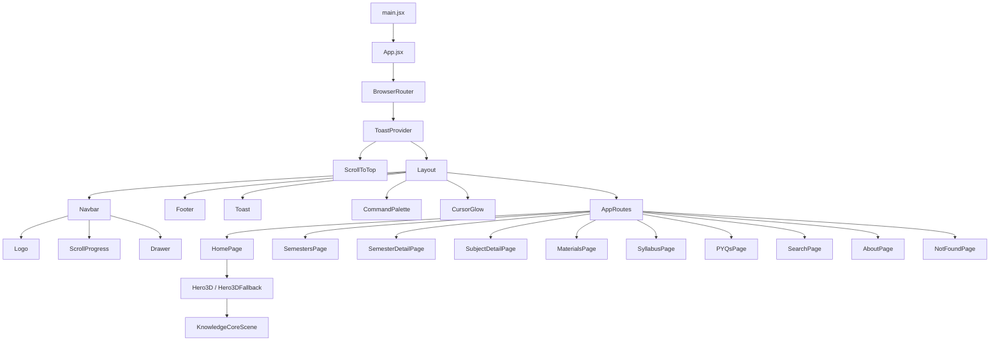

# StudyVerse — Project Knowledge Map

> **Last Audited:** 2026-10-15  
> **Auditor:** Senior Architect / DevOps Audit  
> **Version:** 1.0.0 (Initial Comprehensive Audit)  
> **Repository:** [darshil158/StudyVerse](https://github.com/darshil158/StudyVerse)

---

## 1. Executive Architecture Summary

StudyVerse is a **React 18 single-page application** built with **Vite 5** for GTU (Gujarat Technological University) B.E./B.Tech engineering students. It provides an interactive academic portal covering **8 semesters, 48 subjects**, with curated notes, PPTs, syllabus breakdowns, and previous-year question papers (PYQs).

**Architecture pattern:** Client-side SPA with optional Supabase cloud backend. The app features a **dual data-source strategy** — every API function attempts Supabase first and falls back to comprehensive local static data, allowing the app to run fully offline without any database.

**Design identity:** Dark-mode space/cosmic theme with glassmorphism, 3D WebGL scene (Three.js), Framer Motion animations, and Tailwind CSS v3.

---

## 2. Technology Stack

| Layer | Technology | Version |
|---|---|---|
| UI Framework | React | 18.3.1 |
| Build Tool | Vite | 5.4.6 |
| Styling | Tailwind CSS | 3.4.11 (with PostCSS + Autoprefixer) |
| 3D Rendering | Three.js + @react-three/fiber + drei + postprocessing | 0.168 / 8.17.9 / 9.114 / 2.16.2 |
| Animation | Framer Motion | 11.5.4 |
| Icons | Lucide React | 0.441.0 |
| Routing | React Router DOM | 6.26.2 |
| Backend Client | @supabase/supabase-js | 2.45.4 |
| Language | JavaScript (ES modules, JSX) | — |
| Fonts | Space Grotesk, Inter, JetBrains Mono (Google Fonts CDN) | — |
| License | MIT | — |

---

## 3. Folder and File Map

```
StudyVerse/
├── index.html                  # HTML shell (SEO meta, OG tags, fonts, Vite entry)
├── package.json                # Deps, scripts (dev / build / preview)
├── vite.config.js              # Vite config (React plugin, port 5173, host: true)
├── tailwind.config.js          # Extensive custom design tokens (space theme, 8 semester colors)
├── postcss.config.js           # PostCSS: tailwindcss + autoprefixer
├── vercel.json                 # Vercel SPA rewrite rule (/* -> /index.html)
├── .env.example                # Template for VITE_SUPABASE_URL, VITE_SUPABASE_ANON_KEY
├── .gitignore                  # Standard (node_modules, dist, .env)
├── LICENSE                     # MIT
├── README.md                   # Comprehensive project README (18.5 KB)
│
├── dist/                       # Pre-built production bundle (committed)
│   ├── index.html
│   └── assets/
│       ├── Hero3D-B3P3iE3B.js  # 3D chunk (~895 KB, code-split)
│       ├── index-gZbK2inE.js   # Main bundle (~717 KB)
│       └── index-C0A1oz80.css  # Compiled CSS (~50 KB)
│
├── src/
│   ├── main.jsx                # ReactDOM.createRoot entry (StrictMode)
│   ├── App.jsx                 # BrowserRouter -> ToastProvider -> ScrollToTop -> Layout -> AppRoutes
│   ├── index.css               # Tailwind directives, scrollbar, glassmorphism, cosmic grid/noise
│   │
│   ├── routes/
│   │   └── AppRoutes.jsx       # 11 routes (Suspense-wrapped) + 404 catch-all
│   │
│   ├── components/
│   │   ├── 3d/
│   │   │   ├── Hero3D.jsx              # WebGL canvas wrapper (lazy, IO, WebGL check)
│   │   │   ├── Hero3DFallback.jsx      # SVG orbital map (no-WebGL / reduced motion)
│   │   │   └── KnowledgeCoreScene.jsx  # Three.js scene (core, 8 planets, particles, bloom)
│   │   ├── common/                     # 16 reusable UI components
│   │   │   ├── AnimatedCounter.jsx
│   │   │   ├── Breadcrumbs.jsx
│   │   │   ├── CommandPalette.jsx      # Ctrl+K global search
│   │   │   ├── CursorGlow.jsx
│   │   │   ├── Drawer.jsx
│   │   │   ├── Dropdown.jsx
│   │   │   ├── EmptyState.jsx
│   │   │   ├── ErrorState.jsx
│   │   │   ├── FileTypeBadge.jsx
│   │   │   ├── Logo.jsx
│   │   │   ├── Modal.jsx
│   │   │   ├── SearchBar.jsx
│   │   │   ├── SemesterOrbitRing.jsx
│   │   │   ├── Skeleton.jsx
│   │   │   ├── Tabs.jsx
│   │   │   └── Toast.jsx
│   │   └── layout/
│   │       ├── Layout.jsx              # App shell
│   │       ├── Navbar.jsx              # Sticky glassmorphism navbar
│   │       ├── Footer.jsx              # Multi-column footer
│   │       └── ScrollProgress.jsx      # Scroll progress bar
│   │
│   ├── features/                       # Domain-specific components
│   │   ├── materials/
│   │   │   ├── MaterialFilterBar.jsx
│   │   │   └── ResourceCard.jsx
│   │   ├── pyqs/
│   │   │   ├── PYQCard.jsx
│   │   │   └── PYQFilterBar.jsx
│   │   ├── semesters/
│   │   │   └── SemesterCard.jsx
│   │   ├── subjects/
│   │   │   ├── SubjectCard.jsx
│   │   │   └── SubjectTabs.jsx
│   │   └── syllabus/
│   │       └── SyllabusUnit.jsx
│   │
│   ├── pages/                          # 10 page components
│   │   ├── HomePage.jsx
│   │   ├── SemestersPage.jsx
│   │   ├── SemesterDetailPage.jsx
│   │   ├── SubjectDetailPage.jsx
│   │   ├── MaterialsPage.jsx
│   │   ├── SyllabusPage.jsx
│   │   ├── PYQsPage.jsx
│   │   ├── SearchPage.jsx
│   │   ├── AboutPage.jsx
│   │   └── NotFoundPage.jsx
│   │
│   ├── hooks/                          # 11 custom React hooks
│   │   ├── useDebounce.js
│   │   ├── useIntersectionObserver.js
│   │   ├── useMaterials.js
│   │   ├── usePYQs.js
│   │   ├── usePrefersReducedMotion.js
│   │   ├── useSearch.js
│   │   ├── useSemesters.js
│   │   ├── useSubject.js
│   │   ├── useSubjects.js
│   │   ├── useSyllabus.js
│   │   └── useToast.jsx
│   │
│   ├── services/
│   │   ├── api.js                      # Supabase-first -> local fallback
│   │   └── download.js                 # Resource view/download helpers
│   │
│   ├── lib/
│   │   ├── supabase.js                 # Conditional Supabase client
│   │   └── utils.js                    # Utility functions and color constants
│   │
│   └── data/                           # Static local data (7 files)
│       ├── semesters.js                # 8 semesters
│       ├── subjects.js                 # 48 subjects (44 KB)
│       ├── syllabus_units.js           # Syllabus breakdowns (16 KB)
│       ├── materials.js                # 144 materials (auto-generated)
│       ├── pyqs.js                     # 192 PYQs (auto-generated)
│       ├── categories.js               # 6 categories
│       └── stats.js                    # Platform statistics
│
└── supabase/
    ├── migrations/
    │   └── 001_schema.sql              # 6 tables, FKs, indexes, RLS
    └── seed/
        └── seed.sql                    # Matching seed data
```

---

## 4. Routing Map

| Path | Page Component | Description |
|---|---|---|
| `/` | `HomePage` | Landing: 3D hero, search, stats, featured content |
| `/semesters` | `SemestersPage` | Grid of all 8 semesters |
| `/semester/:id` | `SemesterDetailPage` | Single semester subjects, prev/next nav |
| `/subject/:id` | `SubjectDetailPage` | Tabbed view (overview, syllabus, materials, PYQs) |
| `/materials` | `MaterialsPage` | All materials with filters |
| `/materials/pdfs` | `MaterialsPage` | Materials (pre-filtered to PDFs) |
| `/materials/ppts` | `MaterialsPage` | Materials (pre-filtered to PPTs) |
| `/syllabus` | `SyllabusPage` | All syllabus units |
| `/pyqs` | `PYQsPage` | All PYQ papers |
| `/search` | `SearchPage` | Universal search (URL query `?q=`) |
| `/about` | `AboutPage` | Platform info |
| `*` | `NotFoundPage` | 404 catch-all |

---

## 5. Component Dependency Graph



---

## 6. Data Flow and State Management

### 6.1 State Architecture
- **No global state library** (no Redux, Zustand, or Context stores other than Toast)
- State is **local** to each page/component via `useState` + custom hooks
- Custom hooks encapsulate async fetch + loading/error states
- **Toast state** is the only cross-component context (`ToastProvider`)

### 6.2 Data Access Pattern
```
Page Component
  |-- Custom Hook (e.g., useMaterials)
       |-- API Service Function (e.g., getMaterials)
            |-- IF isSupabaseConfigured() -> Supabase Query
            |    |-- Maps snake_case -> camelCase
            |-- ELSE -> Local static JS data (src/data/*.js)
```

### 6.3 Local Data Sources

| File | Records | Generation |
|---|---|---|
| `semesters.js` | 8 | Hand-curated |
| `subjects.js` | 48 (6 per semester) | Hand-curated |
| `syllabus_units.js` | ~60+ units | Hand-curated + auto-generated |
| `categories.js` | 6 | Hand-curated |
| `materials.js` | 144 (3 per subject) | Auto-generated from SUBJECTS |
| `pyqs.js` | 192 (4 per subject) | Auto-generated from SUBJECTS |
| `stats.js` | 6 | Hand-curated |

### 6.4 Search System
- `searchAll()` operates on local data only (does NOT use Supabase)
- Searches across: subjects, materials, syllabus_units, PYQs
- Debounced via `useDebounce` (250ms)
- URL-synced via query parameter `?q=`
- `CommandPalette` provides Ctrl+K quick search overlay

---

## 7. Database Schema (Supabase)

### 7.1 Tables

| Table | PK Type | Key Relationships |
|---|---|---|
| `semesters` | `integer` | Root table |
| `categories` | `text` | Root table |
| `subjects` | `text` | FK to semesters(id), FK to categories(id) |
| `syllabus_units` | `text` | FK to subjects(id) CASCADE |
| `materials` | `text` | FK to subjects(id) CASCADE, FK to semesters(id) CASCADE |
| `pyqs` | `text` | FK to subjects(id) CASCADE, FK to semesters(id) CASCADE |

### 7.2 Security Model
- **Row Level Security (RLS)** enabled on all 6 tables
- **Public read-only** SELECT policies for all users
- No write/insert/update/delete policies (read-only public access)
- No authentication system implemented

### 7.3 Indexes
Performance indexes on: `subjects(semester_id)`, `subjects(category_id)`, `syllabus_units(subject_id)`, `materials(subject_id)`, `materials(semester_id)`, `materials(type)`, `pyqs(subject_id)`, `pyqs(semester_id)`, `pyqs(year, season)`.

---

## 8. Environment Variables

| Variable | Purpose | Required |
|---|---|---|
| `VITE_SUPABASE_URL` | Supabase project REST API URL | **Optional** |
| `VITE_SUPABASE_ANON_KEY` | Supabase anonymous public key | **Optional** |

> **Note:** No `.env` file exists locally. The app runs entirely on local static data.

---

## 9. Build and Development

### 9.1 Scripts

| Command | Action |
|---|---|
| `npm run dev` | Vite dev server (port 5173, host: true) |
| `npm run build` | Production build to `dist/` |
| `npm run preview` | Serve production build locally |

### 9.2 Build Output (Committed)

| Asset | Size |
|---|---|
| `Hero3D-B3P3iE3B.js` | ~895 KB (3D scene, code-split) |
| `index-gZbK2inE.js` | ~717 KB (main bundle) |
| `index-C0A1oz80.css` | ~50 KB (Tailwind CSS) |

### 9.3 Code Splitting
- `Hero3D.jsx` is lazy-loaded via `React.lazy()` in `HomePage.jsx`
- All other pages are eagerly imported in `AppRoutes.jsx`

---

## 10. Integration Status

### 10.1 GitHub
| Aspect | Status | Detail |
|---|---|---|
| Remote URL | **Connected** | `https://github.com/darshil158/StudyVerse.git` |
| Default Branch | `main` | Tracks `origin/main` |
| Working Tree | Clean | Synced at commit `fbc851f` ("style: restructure and align all cards with balanced typography, icons, and buttons") |
| Connected Platforms | **Verified** | Linked directly to Vercel, Render, and Supabase |
| CI/CD Workflows | None | No `.github/workflows/` configured; builds are handled natively by Vercel & Render webhooks |

### 10.2 Vercel (Production Frontend 1)
| Aspect | Status | Detail |
|---|---|---|
| Project & Team | **Connected** | Project `studyverse` under account `animelover` (Hobby) |
| Deployment Status | **Deployed & Ready** | Production deployment `studyverse-3p6i4m7bo-animelover.vercel.app` |
| Primary Custom Domain | **Live** | `https://studyverse-bay.vercel.app` |
| Trigger & Commit | Synced | Deploys automatically from `main` branch upon push |
| Configuration File | Configured | `vercel.json` provides SPA fallback routing (`/*` -> `/index.html`) |
| Observability | Active | Telemetry active with CDN requests recorded |
| OG Meta URL | **Resolved** | `index.html` updated to match live `https://studyverse-bay.vercel.app/` |

### 10.3 Render (Production Frontend 2)
| Aspect | Status | Detail |
|---|---|---|
| Service Type | Static Site | Service ID: `srv-dat72d8473hc73f0rb70` in workspace `My Workspace / Production` |
| Deployment Status | **Deployed & Live** | `https://studyverse-e8za.onrender.com` |
| Source & Trigger | Synced | Auto-deploys from GitHub `darshil158/StudyVerse` on branch `main` |
| Environment Variables | **Configured** | `VITE_SUPABASE_URL` and `VITE_SUPABASE_ANON_KEY` injected in Render dashboard |
| Fallback Routing | To Verify | Ensure rewrite rule (`/* -> /index.html`) is set in Render Redirects/Rewrites for SPA routing |

### 10.4 Supabase (Cloud Backend & Database)
| Aspect | Status | Detail |
|---|---|---|
| Project Name & ID | **Active & Healthy** | Project `StudyVerse` (Ref: `cpirotcvzrbebzsabhtv`) under org `CampusHub (Free)` |
| API URL | Configured | `https://cpirotcvzrbebzsabhtv.supabase.co` |
| Infrastructure | Healthy (Nano) | AWS `ap-south-1` (Mumbai), `t3.nano`, 6/60 connections, CPU 2%, RAM 52% |
| Git Connection | **Connected** | Linked to repository `darshil158/StudyVerse` |
| Database Schema / Migrations | **Pending Migration** | "No migrations" run on remote DB yet; schema definition exists in `supabase/migrations/` |
| Production Client Sync | Connected via Render | Render environment variables supply `VITE_SUPABASE_URL` and `VITE_SUPABASE_ANON_KEY` |
| Local Development Client | Local Fallback | Local dev has no `.env`; gracefully falls back to bundled static datasets in `src/data/` |

---

## 11. Authentication and Authorization

- **No authentication system** implemented
- No login/signup pages, no auth context, no protected routes
- Supabase RLS policies are public read-only
- The app is fully public/anonymous

---

## 12. SEO and Accessibility

### 12.1 SEO
- Title tag with keyword-rich content
- Meta description (GTU-specific)
- Keywords meta tag
- Open Graph tags (type, url, title, description)
- Twitter Card tags
- **Missing:** `og:image`, `twitter:image`, `robots.txt`, `sitemap.xml`

### 12.2 Accessibility
- `prefers-reduced-motion` respected (CSS + JS hook)
- `aria-label` on key buttons
- WebGL fallback for non-capable devices
- Semantic HTML structure
- **Missing:** Skip-to-content link, ARIA landmarks

---

## 13. Technical Debt and Issues

### 13.1 Critical

| # | Issue | Location | Impact |
|---|---|---|---|
| 1 | `dist/` committed to repo | Root | Build artifacts bloat repo (~1.6 MB) |
| 2 | All page imports are eager | `AppRoutes.jsx` L5-14 | No code splitting for pages beyond Hero3D |
| 3 | `searchAll()` ignores Supabase | `api.js:318-366` | Inconsistent with other API functions |

### 13.2 Moderate

| # | Issue | Location | Impact |
|---|---|---|---|
| 4 | Vercel URL mismatch | `index.html` vs live deployment | `index.html` specifies `studyverse-gtu.vercel.app` while active domain is `studyverse-bay.vercel.app` |
| 5 | Dummy file URLs | `materials.js`, `pyqs.js` | All resources point to same PDF |
| 6 | Randomized download counts | `materials.js:14`, `pyqs.js:15` | Counts change on every page load |
| 7 | No test suite | Entire project | No testing framework |
| 8 | No linting/formatting config | Root | No ESLint or Prettier |

### 13.3 Minor

| # | Issue | Location | Impact |
|---|---|---|---|
| 9 | No error boundary | App-level | Runtime errors crash entire app |
| 10 | Missing `og:image` | `index.html` | No social media preview image |
| 11 | No `robots.txt` / `sitemap.xml` | Root | SEO gap |
| 12 | Large 3D bundle | Hero3D chunk ~895 KB | Significant download for hero |
| 13 | Unused `Heart` icon import | `Footer.jsx:3` | Dead import |

---

## 14. Key Design Decisions

1. **Dual data source (Supabase + Local):** Try Supabase first, fall back to local. Zero-config operation and graceful degradation.
2. **Cosmic space theme:** Dark space metaphor encoded in design tokens, CSS, and component naming.
3. **Per-semester color system:** 8 unique color palettes with glow, badge, border, and light variants.
4. **Feature-based folder structure:** Components organized by domain with shared UI in `components/common/`.
5. **Accessibility-first 3D:** WebGL availability and reduced-motion checks with SVG fallback.

---

## 15. Dependency Health

| Package | Status | Notes |
|---|---|---|
| `react@18.3.1` | Current | |
| `vite@5.4.6` | Minor behind | Vite 6.x available |
| `tailwindcss@3.4.11` | Major behind | Tailwind v4 available (breaking) |
| `@supabase/supabase-js@2.45.4` | Current | |
| `react-router-dom@6.26.2` | Current | |
| `framer-motion@11.5.4` | Current | |
| `three@0.168.0` | Minor behind | Three.js releases frequently |
| `lucide-react@0.441.0` | Current | |

---

## 16. Production Readiness Checklist

| Check | Status |
|---|---|
| Functional SPA routing | Yes |
| 404 handling | Yes |
| Loading states (skeletons) | Yes |
| Error states with retry | Yes |
| Empty states | Yes |
| Mobile responsive | Yes |
| Dark mode | Yes (Always dark) |
| SEO meta tags | Partial |
| Accessibility | Partial |
| Testing | None |
| CI/CD Pipeline | None |
| Error monitoring | None |
| Analytics | None |
| Real document URLs | No (Dummy PDFs) |
| Authentication | Not needed currently |

---

*This document should be consulted before making any changes to StudyVerse. Update it whenever architecture, integrations, or major dependencies change.*
